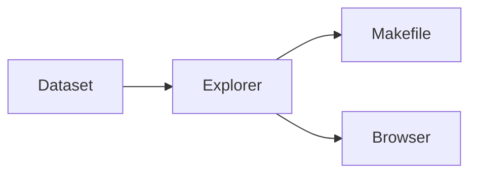

# Ethereum Block Explorer

Analyze your own Ethereum CSV exports privately in the browser, or explore the bundled 100-block sample. No backend, no account, no uploads. Your files never leave the machine.



## How it works

1. **Load.** Pick your CSV exports in the browser. Parsing, validation, and indexing happen in a web worker. Files are never uploaded.
2. **Explore.** Block timelines, address profiles, miner breakdowns, gas analysis, anomaly detection.
3. **Report.** `make report` writes a Markdown summary you can keep.

The same engine backs the browser UI and the JSON CLI, so results agree across surfaces.

## Quickstart

```bash
make dashboard   # summary in the terminal
make ui          # http://localhost:4173
make verify      # same gate as CI
```

Look up a block or address:

```bash
make block N=15049311
make address ADDR=0x58a5b1a1c67e984247a0c78f2875b0f9c781b64f
make report      # writes ethereum-report.md
```

## Load your data

Run `make ui`, select **Load your CSVs**, and choose both exports. Each file can be up to 25 MiB.

The import boundary uses these positional schemas:

- Blocks CSV: block number at column 1 (`[0]`), miner address at column 10 (`[9]`), Unix timestamp at column 17 (`[16]`), transaction count at column 18 (`[17]`).
- Transactions CSV: block number at column 4 (`[3]`), transaction index at column 5 (`[4]`), sender at column 6 (`[5]`), recipient at column 7 (`[6]`, blank for contract creation), gas limit at column 9 (`[8]`), gas price at column 10 (`[9]`).

Imports reject malformed rows and duplicate block numbers. Parsing stops at 64 columns, 25,000 block rows, or 100,000 transaction rows with an actionable error. Gas values must resolve to non-negative base-10 integers; the bounds are 1,000,000,000 gas and 1,000,000,000,000,000 wei per gas. Transactions outside the imported block range are excluded. Use the bundled CSV links in the import dialog as schema examples.

Large views stay bounded: the timeline renders at most 400 cells, each spark chart renders at most 240 sampled points, transaction tables page at 50 rows. All imported blocks and matching transactions remain indexed for search.

Dataset files live in the repo root: `ethereumP1data.csv`, `ethereumtransactions1.csv`.

## Commands

| Command | Output |
| :-- | :-- |
| `make help` | Command guide and runtime requirements |
| `make dashboard` | Human-readable dataset summary |
| `make ui` | Static browser explorer |
| `make block N=15049311` | Block JSON |
| `make address ADDR=0x...` | Address profile JSON |
| `make network` | Network analysis JSON |
| `make anomalies THRESHOLD=1.5` | Anomaly analysis JSON |
| `make miners` | Unique miner breakdown JSON |
| `make report` | Writes ethereum-report.md |
| `make brief` | Action brief |
| `make snapshot` | Compact JSON context packet |
| `make run` | Interactive menu |
| `make verify` | Workflow contracts + JUnit + CLI + dependency audit + TypeScript + browser smoke |

Port override: copy `.env.example` to `.env`, set `UI_PORT`. Static deploy: `vercel.json` publishes `web/out/`.

## Verify

Requires Python 3 (`make ui`), a JDK (CLI + tests), and Node.js 24 LTS (browser build and verification).

```bash
npm ci
npm run ui:install-browsers
make verify
```

The gate installs the locked web dependencies once, audits all production dependency severities, checks workflow credential routing and TypeScript, and exercises the CLI, CSV importer, and exported browser UI. An audit failure stops verification. Web dependencies stay on the Next.js 15.5 and React 19.1 release lines; scoped overrides keep Next.js's PostCSS and sharp dependencies patched.

MIT · [LICENSE](LICENSE)
